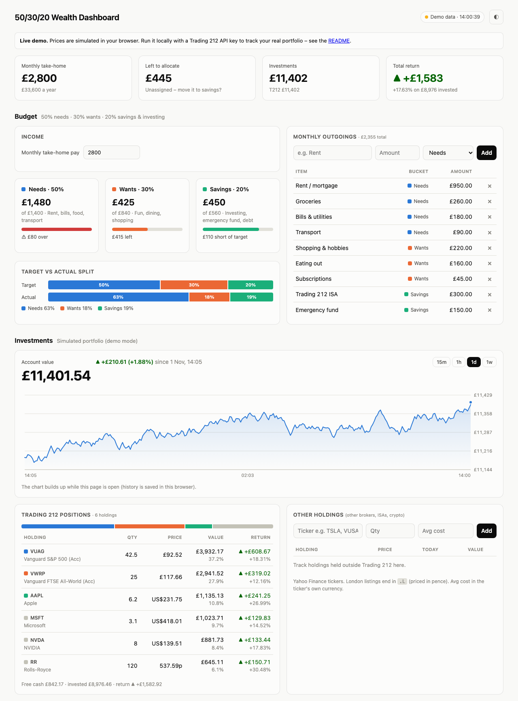
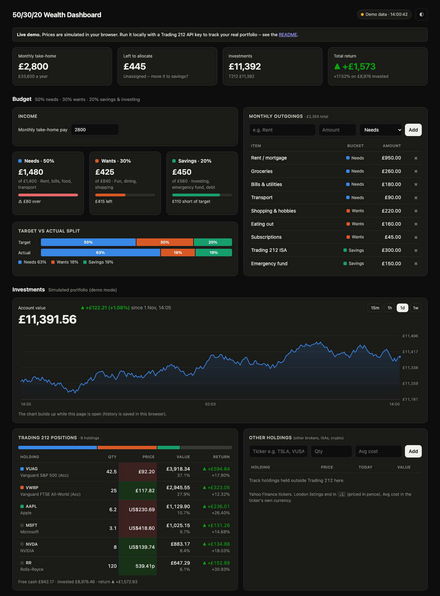

# 50/30/20 Wealth Dashboard

A personal finance dashboard that combines **50/30/20 budgeting** with **live investment tracking** from Trading 212.

**[▶ Try the live demo](https://bk101-design.github.io/budget-dashboard/)** – runs in your browser with a simulated portfolio, so no account is needed.



<details>
<summary>Dark mode</summary>


</details>

## Why I built it

The 50/30/20 rule says to spend 50% of take-home pay on needs, 30% on wants, and put 20% into savings and investing. Budgeting apps track the spending, and broker apps track the investments, but neither shows whether the money is actually going where the plan says. This dashboard puts both on one screen: the budget says how much should go into investing, and the portfolio shows what that money is doing in real time.

## Features

**Budget**
- Enter your monthly take-home pay and outgoings, and tag each as *Needs*, *Wants* or *Savings*.
- See target vs. actual for each bucket, with progress meters and over-budget warnings. Overspending on savings counts as a good thing.
- A stacked bar compares your actual split with the ideal 50/30/20 split.

**Investments**
- **Live Trading 212 sync**: positions, prices, returns and account value, refreshed every 5 seconds. That's as fast as the Trading 212 API allows.
- Prices flash green or red as they move. The account-value chart has 15m / 1h / 1d / 1w ranges and a hover crosshair.
- Foreign holdings (USD shares, pence-priced London shares) are converted into your account currency using live exchange rates.
- **Other holdings**: add tickers held at other brokers, or crypto (`TSLA`, `VUSA.L`, `BTC-USD`). Their live prices come from Yahoo Finance.

**General**
- Light and dark mode, a responsive layout, and support for reduced motion.
- Your budget and holdings stay in your browser's local storage. Nothing is sent to a third-party server.

## How it works

```
Browser (public/)  ──►  server.js (Node, localhost only)  ──►  Trading 212 API
                                                        └──►  Yahoo Finance (quotes, FX)
```

- **Your API key stays on your computer.** `server.js` is a small proxy that adds the key to requests on the server, so the key never reaches the browser. It only listens on `127.0.0.1`.
- **Zero dependencies.** It's plain Node (`http` + built-in `fetch`) and vanilla JS/CSS, with no build step and no packages to install.
- **Respects rate limits.** Each Trading 212 endpoint is cached according to its documented limit (portfolio 5s, account info 10 min, instruments metadata 6h), and repeated requests for the same data share one call.
- **Demo mode everywhere.** With no API key, the server simulates a market: one shared market move plus a smaller random move per stock. With no server at all (GitHub Pages), the same simulation runs in the browser. `public/demo.js` is shared by both.
- **Tested budget logic.** The 50/30/20 maths in `public/budget.js` is a pure function shared by the UI and the unit tests.

## Run it locally

You need Node 18 or newer.

```bash
git clone https://github.com/BK101-design/budget-dashboard.git
cd budget-dashboard
npm start        # → http://localhost:3212
npm test         # budget unit tests
```

### Connect your Trading 212 account

1. In Trading 212, go to **Settings → API (Beta)** and generate a key with **read-only** permissions: *Account data*, *Portfolio* and *Metadata*. Leave order placement off.
2. `cp .env.example .env` and paste your key (and secret, if you were given one) into `.env`.
3. Set `T212_ENV=demo` if the key is for a Practice account.
4. Restart with `npm start`. The status badge should change to **Trading 212 live**.

`.env` is git-ignored, so your key can't be committed by accident.

## Limitations

- Trading 212's API doesn't give past account values, so the live chart builds up while the dashboard is open. The demo chart starts with a simulated day of history.
- Trading 212 doesn't report today's change for positions, so only the total return is shown for them.
- Yahoo Finance's quote endpoint is unofficial and could change without notice.

## Ideas for next steps

- Import bank transactions from a CSV and auto-categorise them into needs, wants and savings.
- Monthly snapshots to track budget adherence over time.
- Dividend and deposit history from the Trading 212 API.
- Optional hosted version with authentication.

## License

[MIT](LICENSE)
